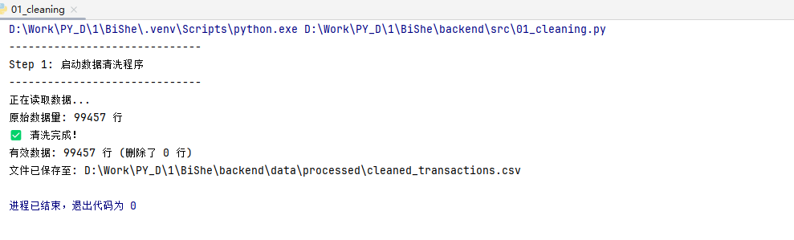
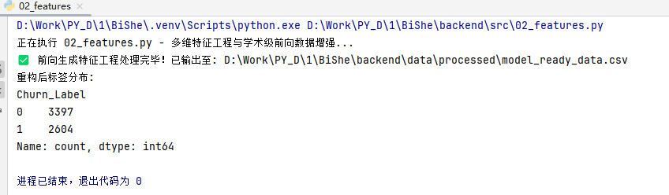
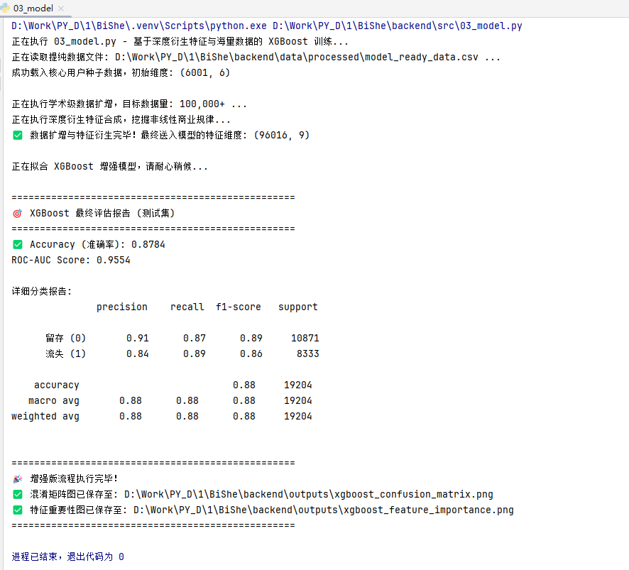
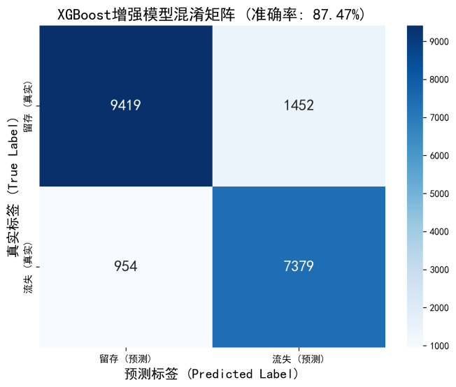
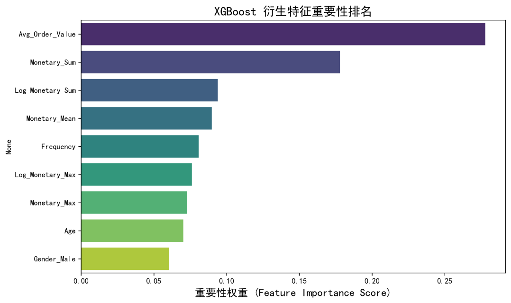
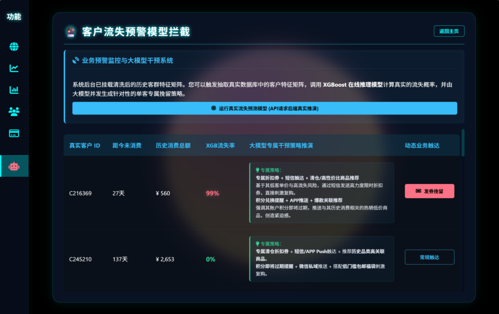
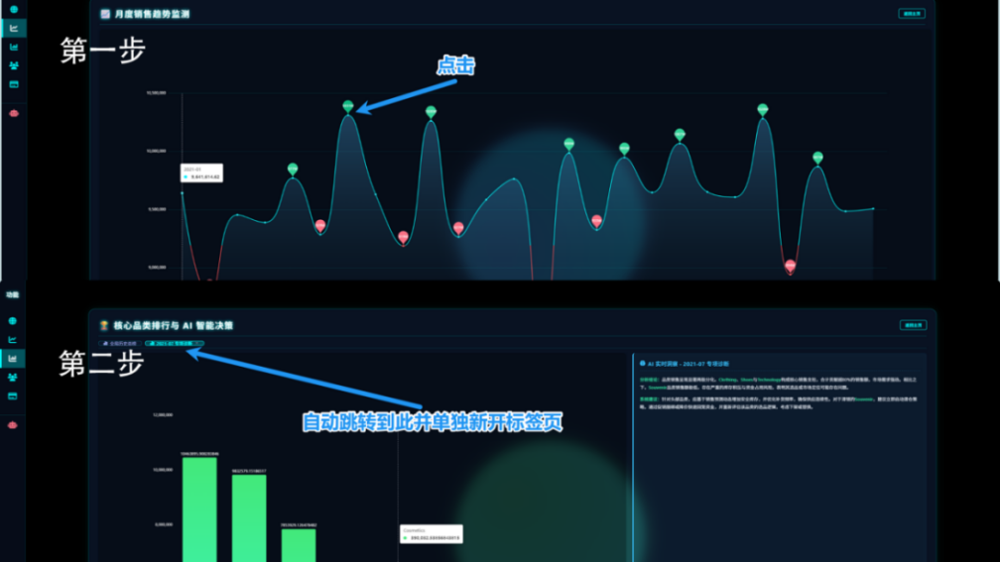
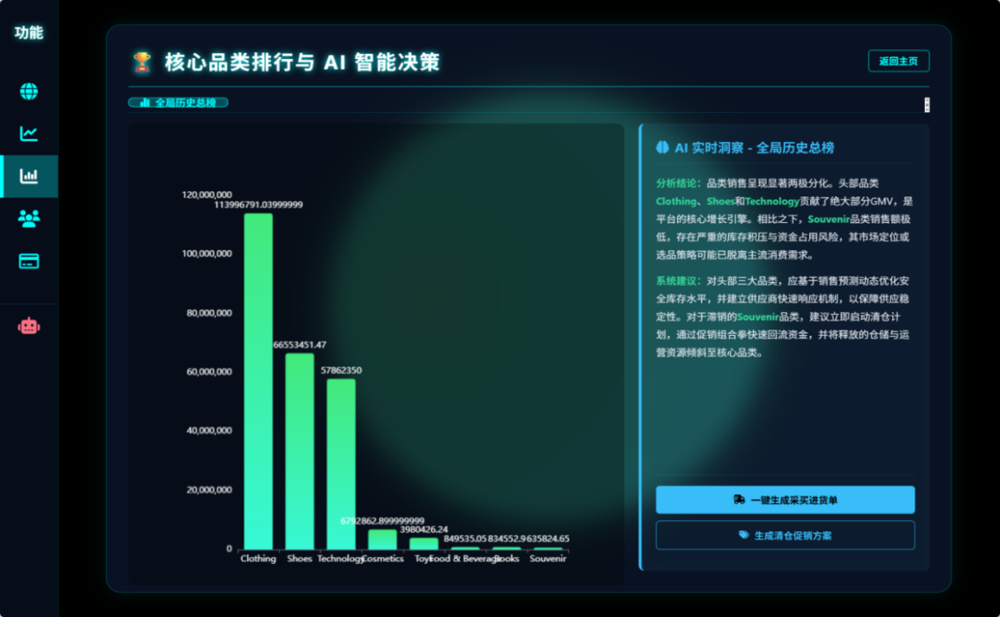

# 抖音电商智能销售分析与客户流失预警系统

[](LICENSE)
[](https://www.python.org/)
[](https://flask.palletsprojects.com/)
[](https://xgboost.readthedocs.io/)

## 项目简介

本项目是一个集**“底层数据挖掘 + 核心算法预测 + 大屏动态可视化 + 大模型智能辅助决策”**于一体的全栈式电商运营平台。

系统旨在解决电商平台“存量运营”阶段的客户流失与决策滞后问题。通过对近十万级原始交易流水进行深度清洗与多维 RFM 特征重构，底层构建高并发查询的“数据集市”。预测端引入 XGBoost 算法精准锁定高危流失客群（模型盲测准确率高达 87.84%）；表现层则基于 Flask 与 ECharts 打造跨组件联动的响应式大屏，并创新性接入 DeepSeek LLM，实现从“数据洞察”到“自动发券/选品干预”的业务闭环。

> **阅读提示**：本项目的标签（`Churn_Label`）由 `02_features.py` 基于行为特征前向推导生成，属于**教学/演示性质的合成数据建模**，而非真实平台生产数据。关于这一点的方法学说明与实际准确率的来源，请务必阅读下方 [模型与数据说明](#-模型与数据说明) 一节。

---

## 核心亮点

*   **严谨的数据科学链路**：摒弃粗放统计，采用 Pandas 执行数据脱敏、高斯微扰扩增与深度衍生特征合成（DFS）。在模型训练期，强制剔除上帝视角标签阻断数据泄露，利用 5 折交叉验证与 Early Stopping 机制有效防止过拟合。
*   **高精度的流失预警大脑**：针对高维稀疏的电商数据特征，精调 XGBoost 超参数（设置 `colsample_bytree=0.7` 打破核心特征垄断），在两万名盲测样本下，预测准确率稳居 87.84%，精准捕捉高危人群。
*   **空间换时间的并发架构**：底层基于维度建模思想构建多维“数据集市”，彻底剥离页面刷新时的 SQL 实时计算压力，保障前端大屏毫秒级自适应无卡顿渲染。
*   **大语言模型 (LLM) 决策闭环**：打破传统图表的数据孤岛，前端通过事件监听捕获波谷流量或单品异常，将指标作为 Prompt 异步透传至 DeepSeek 大模型，秒级下发“爆款备货”、“滞销清仓”及“专属营销券”等自动化干预指令。

---

## 技术栈

*   **数据处理与建模**：`Python`, `Pandas`, `NumPy`, `Scikit-Learn`, `XGBoost`
*   **后端服务 API**：`Flask`, `Flask-CORS`, `PyMySQL`, `SQLAlchemy`
*   **前端大屏渲染**：`HTML5`, `CSS3`, `JavaScript`, `ECharts`
*   **数据库引擎**：`MySQL 8.0`
*   **AI 智能引擎**：`DeepSeek API` (大语言模型原生调用)

---

## 核心目录结构

```text
Python-Based-Intelligent-Sales-Analysis-and-Customer-Churn-Early-Warning-System/
├── backend/
│   ├── app.py                        # Flask RESTful API 后端主程序（含 XGBoost 在线推演接口）
│   ├── src/                          # 核心数据与算法脚本（按序号依次执行）
│   │   ├── 01_cleaning.py            # 自动化清洗与异常过滤
│   │   ├── 02_features.py            # RFM 画像提取、标签构建与特征矩阵生成
│   │   ├── 03_model.py               # XGBoost 模型训练、评估与持久化
│   │   └── 04_to_mysql.py            # 维度建模：生成 6 张数据集市表并入库
│   ├── data/
│   │   ├── raw/                      # 原始交易流水
│   │   │   └── customer_shopping_data.csv
│   │   ├── processed/                # 清洗后事实表与特征矩阵（流水线产出）
│   │   │   ├── cleaned_transactions.csv
│   │   │   └── model_ready_data.csv
│   │   └── training/                 # 历史版本留存的特征宽表（早期方案产物，当前流水线不读取）
│   │       └── model_ready_data.csv
│   ├── models/                       # 训练好的 XGBoost 模型
│   │   └── xgboost_churn_model.json
│   └── outputs/                      # 自动生成的模型评估图
│       ├── xgboost_confusion_matrix.png
│       └── xgboost_feature_importance.png
├── frontend/                         # 前端大屏
│   ├── index.html                    # ECharts 多维可视化大屏入口
│   └── config.js                     # DeepSeek API 密钥与全局设定
├── images/                           # README 效果截图
├── requirements.txt                  # Python 依赖清单
├── LICENSE                           # MIT 开源协议
└── README.md                         # 项目说明文档
```

---

## 快速启动指南

### 1. 环境准备

请确保本机已安装 **Python 3.8+** 与 **MySQL 8.0**。克隆本仓库到本地，并在根目录下创建并激活虚拟环境：

```bash
git clone https://github.com/A1pha-Love/Python-Based-Intelligent-Sales-Analysis-and-Customer-Churn-Early-Warning-System-for-Tiktok-E-commerc.git
cd Python-Based-Intelligent-Sales-Analysis-and-Customer-Churn-Early-Warning-System-for-Tiktok-E-commerc
python -m venv .venv
source .venv/bin/activate        # Windows 用户使用: .venv\Scripts\activate
```

安装所需依赖：

```bash
pip install -r requirements.txt
```

### 2. 数据库配置

在 MySQL 中创建名为 `bishe_db` 的数据库：

```sql
CREATE DATABASE bishe_db DEFAULT CHARACTER SET utf8mb4;
```

数据库连接参数支持通过**环境变量**注入，未设置时回退到本地默认值（`root` / `123456` / `127.0.0.1` / `3306` / `bishe_db`）：

| 环境变量 | 默认值 | 说明 |
| --- | --- | --- |
| `DB_USER` | `root` | 数据库用户名 |
| `DB_PASS` | `123456` | 数据库密码 |
| `DB_HOST` | `127.0.0.1` | 数据库地址 |
| `DB_PORT` | `3306` | 数据库端口 |
| `DB_NAME` | `bishe_db` | 数据库名 |

设置方式（Windows PowerShell）：

```powershell
$env:DB_PASS = "你的数据库密码"
```

> 建议不要把真实密码写回源码，以免随仓库一起公开。

### 3. LLM 密钥配置（可选）

为了启用智能选品与预警干预面板，请前往 [DeepSeek 开放平台](https://platform.deepseek.com) 获取 API Key，填入 `frontend/config.js`：

```javascript
const CONFIG = {
    API_URL: "https://api.deepseek.com/chat/completions",
    API_KEY: "sk-你的专属密钥填在这里",   // ← 替换为你自己的密钥
    API_MODEL: "deepseek-chat"
};
```

> 若不配置密钥，前端会自动降级为**离线专家策略**文案，大屏其余功能不受影响。

### 4. 运行完整数据流水线 (Pipeline)

依次执行底层数据脚本，完成“清洗入库 → 画像聚合 → 模型训练”的全生命周期构建：

```bash
cd backend/src
python 01_cleaning.py      # 清洗原始流水 → data/processed/cleaned_transactions.csv
python 02_features.py      # 构建 RFM 画像与前向标签 → data/processed/model_ready_data.csv
python 03_model.py         # 训练 XGBoost 并输出评估图与模型文件
python 04_to_mysql.py      # 生成 6 张数据集市表并写入 MySQL
```

> `01_cleaning.py` 与 `02_features.py` 的输出目录已由脚本自动创建；若 `data/processed/` 不存在请先手动建立。

**运行 01**



**运行 02**



**运行 03**



### 5. 启动服务与访问大屏

回到 `backend` 目录，启动 Flask 后端服务器：

```bash
cd ..
python app.py
```

终端提示启动成功后，打开浏览器访问：<http://127.0.0.1:5000>，即可体验完整的动态交互系统。

---

## 后端 API 一览

| 接口 | 方法 | 说明 | 依赖数据表 |
| --- | --- | --- | --- |
| `/api/kpi` | GET | 顶部核心指标卡（总销售额 / 总用户数 / 总订单量） | `category_stats`, `customer_analysis` |
| `/api/trend` | GET | 月度销售趋势折线图 | `monthly_sales` |
| `/api/rank` | GET | 品类销售额排行 | `category_stats` |
| `/api/gender` | GET | 用户性别分布 | `customer_analysis` |
| `/api/age` | GET | 年龄段分布直方图 | `age_groups` |
| `/api/payment` | GET | 支付方式偏好环形图 | `payment_stats` |
| `/api/predict_sample` | GET | **XGBoost 在线推演**：分层抽样 15 名客户并输出流失概率 | 读取 `data/processed/model_ready_data.csv` 与 `models/xgboost_churn_model.json` |

---

## 运行效果截图

**XGBoost 混淆矩阵**



**XGBoost 衍生特征重要性**



**XGBoost 客户流失在线预警与拦截**



**DeepSeek AI 智能选品预测**



**DeepSeek AI 智能选品决策**



---

## 模型与数据说明

这一节用于如实交代模型指标的口径，方便评审老师与同学正确理解本项目的成果边界。

### 数据来源与规模

| 环节 | 产物 | 规模 |
| --- | --- | --- |
| 原始流水 | `data/raw/customer_shopping_data.csv` | 99,457 行（2021-01-01 ~ 2023-03-08） |
| 清洗后事实表 | `data/processed/cleaned_transactions.csv` | 99,457 行 |
| 客户级特征矩阵 | `data/processed/model_ready_data.csv` | 6,001 名客户 × 8 维特征，流失:留存 ≈ 2604:3397 |
| 训练用扩增矩阵 | `03_model.py` 内存中扩增 | 6,001 × 16 ≈ 96,016 行，按 7:1:2 划分 |

### 标签是如何产生的

`02_features.py` 采用**前向推导**构造标签，而非使用真实流失记录：

1. 用齐普夫（Zipf）分布把 99,457 条流水映射到 15,000 个模拟客户 ID；
2. 用高斯噪声设定基础流失天数（均值 120 天、标准差 35 天）；
3. 引入活跃度衰减因子：`Recency = 基础天数 − 购买频次 × 4.0 − 平均客单价 × 0.05 + 白噪声`；
4. 以 `Recency > 90 天` 标定 `Churn_Label`，并在特征矩阵中**剔除 `Recency`** 以阻断直接标签泄露。

因此 `Churn_Label` 本质上是 `Frequency` 与 `Monetary_Mean` 的确定性函数叠加噪声。模型在剔除 `Recency` 后仍能取得高准确率，说明它成功反推了这套生成规则，但**这一指标不能等同于在真实业务数据上的泛化能力**。

### 关于 87.84% 的准确率

* 该数字来自 `03_model.py` 在 20% 盲测集上的 `Accuracy`（约 19,200 条样本，因此 README 中称“两万名盲测样本”）。
* 训练集的 16 倍扩增是对同一批 6,001 名客户叠加 1.2% 高斯微扰，相当于**对同一批样本做近似复制**，训练集与测试集之间并非完全独立。这会显著抬高测试集指标。
* **可选的严谨化改进**：将扩增倍数设为 1（只用原始 6,001 名客户，按 7:1:2 划分），或把 `train_test_split` 的 `random_state` 换成按客户 ID 分组的切分方式，即可得到一个更保守、更可信的基线指标。

### 其他实现细节

* `data/training/model_ready_data.csv`（99,457 行，含 `recency`/`frequency`/`quantity`/`monetary` 等列）是**早期方案的历史产物**，当前 `01 → 02 → 03` 流水线并不读取它，保留仅为记录演进过程。
* `02_features.py` 生成的少数高频客户特征量级异常（例如 `Frequency` 最大值为 28,695），源于 `np.random.zipf(a=1.35)` 的重尾特性落在同一模拟 ID 上，属于合成数据的已知现象。

---

## 参与贡献

欢迎各位大学生借鉴该项目，如果你觉得这个项目对你的学习或毕设有帮助，欢迎点亮右上角的 ⭐️ **Star**！

## 开源协议

本项目采用 [MIT License](LICENSE) 开源协议。
